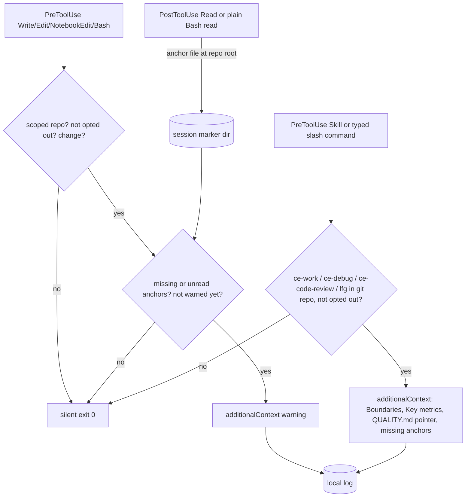

# Governing-document anchors - Plan

## Goal Capsule

- **Objective:** An agent that changes a configured repository is told, before its first change, which governing documents (STRATEGY.md, QUALITY.md, and ARCHITECTURE.md when present) it has not read or that do not exist; compound-engineering steps that never read those documents get their Boundaries and Key metrics in context, with a pointer to the QUALITY.md requirements; and each warning is logged locally so the operator can decide, after about two weeks, whether to switch to blocking.
- **Means:** two warn-only PreToolUse hooks plus a PostToolUse read tracker in this plugin (KTD1, KTD2), and a `packs/repo-anchors/` Compound Pack (KTD8).
- **Authority:** STRATEGY.md and QUALITY.md of this repo, then the settled decisions below, then this plan. ADR-0005 (U1) records the decision before any hook code lands.
- **Execution profile:** ADR first, then BDD scenarios, then TDD with `node:test` per unit.
- **Stop conditions:** stop and report if a hook would need to deny a call, read state from another session, spawn `git`, use the network, or name an organization in code.
- **Who finishes:** the lfg pipeline implements, reviews and opens the PR; the PR auto-merges on green CI. Nobody merges by hand.

---

## Product Contract

### Summary

Add the "Governing-document anchors" track from STRATEGY.md. A read tracker records which anchor files the session read. A gate warns once per repository per session when a change starts before the anchors exist and were read. A reminder adds anchor context when ce-work, ce-debug, ce-code-review or lfg start. A Compound Pack carries the same rules into the CE steps that read packs.

### Problem Frame

The existing hooks surface ADRs and the radar, but nothing checks that STRATEGY.md and QUALITY.md were consulted before a change. CE 3.33.1 does not read QUALITY.md at all, and ce-work, ce-debug, ce-code-review and lfg do not read STRATEGY.md Boundaries (gaps G1 to G4 in the design input). Packs close part of this; hooks close the rest.

### Key Decisions

- **Home is this plugin.** Same concept as its context hooks; no new repo. Governs R1-R13. (session-settled: user-approved — chosen over a new gate plugin repo: fit test showed the concept, vocabulary and mechanism already live here)
- **A change is any file change.** Edit, Write, NotebookEdit, detectable shell writes and git commit, docs included. Governs R4, R6. (session-settled: user-directed — chosen over code-only or commit-only: anchors govern every change)
- **Consulted means read in this session.** No state across sessions. Governs R1, R2, R4. (session-settled: user-directed — chosen over read-since-last-change and presence-only: STRATEGY.md Boundary "No state across sessions in hooks")
- **Warn only.** Never deny; a switch to deny needs an operator-approved PR after about two weeks of log evidence. Governs R5, R9, R11. (session-settled: user-directed — chosen over an automatic switch and over warn forever: STRATEGY.md "warn before they block")
- **Scope is a configured owner list.** The code names no organization. Governs R3. (session-settled: user-directed for the owner list, user-approved for config-only — chosen over hard-coding every git repo: QUALITY.md portability factor)
- **The reminder covers ce-work, ce-debug, ce-code-review and lfg.** Each part is removed when upstream EveryInc/compound-engineering-plugin#1947 ships it. Governs R8-R10. (session-settled: user-approved — chosen over forking CE skills: packs do not reach those steps)
- **Pack has three rules.** strategy-boundaries, quality-requirements, key-metrics. Governs R12, R13. (session-settled: user-approved — chosen over rules only in AGENTS.md: CE-native mechanism read by plan, brainstorm and full review)

### Requirements

**Read tracking**

- R1. When the session reads STRATEGY.md, QUALITY.md or ARCHITECTURE.md at a repository root, with the Read tool or a plain read command in Bash, the plugin records that read for this session and repository only.
- R2. Records live only for the session that made them; a new session starts with nothing read.

**Gate**

- R3. The gate acts only in a repository whose `origin` owner is in `SA_ANCHORS_OWNERS` (comma list, case-insensitive, `*` for all); it is silent when the variable is unset, the repository has a `.anchors-opt-out` file, or the path is outside a git repository.
- R4. Before the first change in a scoped repository, the gate warns when STRATEGY.md or QUALITY.md is missing or unread, or ARCHITECTURE.md exists but is unread.
- R5. The warning is additional context, never a deny; it names each missing file with the skill that creates it (ce-strategy for STRATEGY.md, the qualitymd `quality` skill for QUALITY.md, `/software-architecture:context` for ARCHITECTURE.md) and each unread file to read.
- R6. A change is Write, Edit or NotebookEdit on a file inside the repository, or a Bash command that commits or writes files by a detectable pattern.
- R7. The gate warns at most once per repository per session.

**Reminder**

- R8. When the Skill tool or a typed slash command starts compound-engineering ce-work, ce-debug, ce-code-review or lfg in a repository with STRATEGY.md or QUALITY.md, the reminder adds context with the STRATEGY.md Boundaries and Key metrics and a pointer to the QUALITY.md requirements, and asks the agent to say which apply.
- R9. The reminder says which anchor is missing and names the skill that creates it, and never denies.
- R10. The reminder is silent for other skills, outside git, and in an opted-out repository; it does not require the owner list.

**Evidence and opt-out**

- R11. Each gate warning, each reminder, each first change that passes the gate, and each anchor read after a warning appends one line to a local log that no hook reads; `SA_ANCHORS_LOG` sets the log file path, and `off` turns logging off.
- R14. `SA_PLUGIN_HOOKS` gains the keys `anchors` (read tracker and gate) and `anchors-reminder` (reminder), each documented in the README opt-out table.

**Compound Pack**

- R12. `packs/repo-anchors/` holds a README.md and three rule files that CE 3.33.1 discovers (top-level `.md` with `title` and `applies_when`).
- R13. Each rule tells the agent to read the named section of the anchor file in the repository under work and to cite it.

### Acceptance Examples

- AE1. Covers R3, R4. **Given** `SA_ANCHORS_OWNERS=acme` and a repo with origin `git@github.com:Acme/widgets.git` and both anchors present but unread, **when** the agent Edits `src/a.ts`, **then** the gate adds context that names STRATEGY.md and QUALITY.md as unread.
- AE2. Covers R3. **Given** the same repo and `SA_ANCHORS_OWNERS` unset, **when** the agent Edits a file, **then** the gate prints nothing.
- AE3. Covers R1, R4, R7. **Given** the session Read both anchors at the repo root, **when** the agent Edits a file, **then** the gate prints nothing; and a second Edit in a repo that was warned once prints nothing.
- AE4. Covers R4, R5. **Given** QUALITY.md is missing, **when** the agent Writes a file, **then** the context says QUALITY.md is missing and names the qualitymd `quality` skill.
- AE5. Covers R6. **Given** an unread scoped repo, **when** Bash runs `git commit -m x`, **then** the gate warns; **when** Bash runs `ls -la`, **then** it is silent.
- AE6. Covers R8, R10. **When** the Skill tool starts `compound-engineering:ce-work`, or the user types `/compound-engineering:ce-debug`, **then** the reminder context quotes the Boundaries section; **when** the Skill tool starts `compound-engineering:ce-ideate`, **then** it is silent.
- AE7. Covers R1. **Given** an unread scoped repo, **when** Bash runs `cat STRATEGY.md` and `head QUALITY.md` in the repo root, **then** a following Edit is silent; `cat docs/STRATEGY.md` marks nothing.

### Scope Boundaries

- No deny mode, no CI check, no fitness function for anchor format or staleness (Fitness and evolution track).
- No content generation for missing anchors; the hooks name the skill that writes them.

#### Deferred to Follow-Up Work

- claude-config declares the pack in `.compound-engineering/config.yaml` with a pinned release tag (needs a tag cut after this merges).
- The dogfood run that checks a Boundary-breaking diff is flagged with the pack citation.
- claude-config sets `SA_ANCHORS_OWNERS` and, for cloud environments whose home directory is discarded with the container, a persisted `SA_ANCHORS_LOG` path; the two-week warn period starts from that date. Until then the gate is inert by design (KTD4).
- The deny-mode decision after the warn period.

### Sources

- Design input: `/mnt/project-files/repo-anchors/ce-gaps/2026-10-29-ce-anchor-gaps-closure-plan.md` and `repo-anchors-ce-reminder.feature` (project files, outside the repo).
- Pack format: compound-engineering 3.33.1 `docs/guides/packs.md`.
- Hook pattern: `hooks/deps-pretooluse.sh` (opt-out check, jq parsing, silent exit), `test/hooks.test.mjs` (`runHook`, jq skip).

---

## Planning Contract

### Key Technical Decisions

- KTD1. **Read tracking by a PostToolUse hook on `Read|Bash`, with session-scoped markers.** Markers go in `${TMPDIR:-/tmp}/sa-anchors/<session_id>/<repo-key>/`, where `session_id` is reduced to `[A-Za-z0-9-]` and `repo-key` is the `cksum` of the repository's common git directory, so a read in the main checkout counts in its worktrees. For Bash, a plain read (`cat`, `head`, `tail`, `less`, `sed -n`) whose file argument resolves, against the payload `cwd`, to an anchor at the repo root counts as a read. No session id means silent exit. Chosen over scanning `transcript_path`, whose format is internal and can change. Implements the "consulted means read in this session" Key Decision (R1, R2).
- KTD2. **Gate is one PreToolUse hook on `Write|Edit|NotebookEdit|Bash`.** It finds the repo root by walking up from `tool_input.file_path` or `tool_input.notebook_path` (or the payload `cwd` for Bash) to `.git`; a `.git` file is a worktree whose `gitdir`, and that gitdir's `commondir` when present, leads to the config. Implements R4, R6.
- KTD3. **Owner comes from `.git/config` text, not `git`.** Read the `url` under `[remote "origin"]` with awk; the owner is the second-to-last path segment after stripping `.git` and splitting on `/` and `:`. This covers SSH, HTTPS and proxy URLs such as `http://proxy@127.0.0.1:1234/git/Owner/repo`. Implements R3.
- KTD4. **Unset `SA_ANCHORS_OWNERS` means silent.** Least surprising for a public plugin: an installer who has not opted in gets no new warnings in unrelated repos, the same as `SA_RADAR_PATH` unset. `*` opts in to every repo. Recorded in ADR-0005. (Assumption, see below.)
- KTD5. **Shared helpers in `hooks/lib/anchors-common.sh`, sourced by path.** Repo-root walk, owner parse, opt-out check, marker paths and log append live once. Sourcing the plugin's own file is not sourcing input, so the QUALITY.md security veto holds. `hooks/lib/` is not matched by `hookFiles()`, so the shared file is not run as a hook.
- KTD6. **Bash change detection is conservative.** Match `git commit`, `git apply`, `sed -i`, `perl -pi`, `tee`, `mv`, `cp`, `rm`, `touch`, and `>`/`>>` redirection to a target other than `/dev/null` or an fd. A miss is a missed warning, never a block; a false hit is one extra warning per session at most (R7).
- KTD7. **Reminder runs on PreToolUse `Skill` and on UserPromptSubmit; it extracts sections with awk, capped.** On UserPromptSubmit it fires only when the prompt starts with `/` and one of the four skill names, with or without the `compound-engineering:` prefix, followed by a space or the end of the prompt; it then emits `hookEventName: UserPromptSubmit`. It prints the bodies of `## Boundaries` and `## Key metrics` from STRATEGY.md, capped at about 2,000 characters, and points to QUALITY.md factors and requirements without parsing the qualitymd format. Implements R8.
- KTD8. **Pack files follow CE 3.33.1 discovery.** Top-level `.md` with `title`, `applies_when` (list) and `tags`; README.md is the description. A test checks the frontmatter so a broken rule fails CI instead of being skipped silently. Implements R12.
- KTD9. **Log is append-only and local.** `${XDG_STATE_HOME:-$HOME/.local/state}/software-architecture/anchors.log`, one tab-separated line: UTC time, event (`warn`, `pass`, `read-after-warn` or `remind`), repo `owner/name`, tool or skill, missing list, unread list. `pass` uses the same once-per-repo-per-session marker as R7, so `pass` plus `warn` lines give the denominator for the STRATEGY.md metric "Context before change". `SA_ANCHORS_LOG` overrides the path. No file paths outside the repo name, no prompt text. Write failures are ignored. Hooks only append and never read the log, so no hook behavior depends on state from another session; STRATEGY.md Key metrics name the hook log as their data source. Implements R11.

### Assumptions

- Hook payloads carry `session_id`, `cwd`, `tool_name` and `tool_input` as documented for Claude Code hooks; PostToolUse on Read fires after a successful Read.
- The Skill tool's input names the skill in `tool_input.skill` (fallback `tool_input.command`), with or without the `compound-engineering:` prefix.
- A skill the user types as a slash command expands without a Skill tool call, so only UserPromptSubmit sees it.
- An unset owner list is the least surprising default (KTD4); the operator configures `SA_ANCHORS_OWNERS` in their environment setup.

### High-Level Technical Design



### Output structure

```text
docs/adr/0005-warn-before-change-when-governing-documents-are-unread.md
docs/scenarios/governing-document-anchors.feature
hooks/lib/anchors-common.sh
hooks/anchors-read.sh
hooks/anchors-gate.sh
hooks/anchors-reminder.sh
packs/repo-anchors/README.md
packs/repo-anchors/strategy-boundaries.md
packs/repo-anchors/quality-requirements.md
packs/repo-anchors/key-metrics.md
test/anchors.test.mjs
test/packs.test.mjs
```

### Risks

- For Bash, the repo comes from the payload `cwd`; a command that changes into another repository is attributed to the session's repository or missed. A miss costs a warning, never a block.
- Compound Packs are experimental in CE 3.33.1; consumers pin a release tag.

### Sequencing

U1 and U2 first, then U3 (shared lib and read tracker), U4 (gate), U5 (reminder), U6 (pack), U7 (wiring and docs). U4 and U5 depend on U3; U6 is independent.

---

## Implementation Units

### U1. ADR-0005: warn before change when governing documents are unread

- **Goal:** record the decision and its defaults before code lands.
- **Requirements:** R1-R14; Key Decisions above; KTD4.
- **Files:** `docs/adr/0005-warn-before-change-when-governing-documents-are-unread.md`.
- **Approach:** follow the 0004 layout (Status, Context, Decision, Consequences). Record: warn-only and the deny-switch condition; session-scoped markers; owner list with unset = silent; opt-out file and keys; local log; the reminder's removal trigger (#1947); the pack and its consumers. Name no organization or person.
- **Test expectation:** none -- documentation.
- **Verification:** ADR states each Key Decision and KTD4 with the rejected alternative.

### U2. BDD scenarios

- **Goal:** executable-shaped behavior spec that the tests trace to.
- **Requirements:** R1-R13.
- **Files:** `docs/scenarios/governing-document-anchors.feature`.
- **Approach:** gate scenarios from AE1-AE5 plus opt-out, outside git and worktree; reminder scenarios copied from the design input `.feature` (Layer 2), keeping its wording; pack scenarios (Layer 1) marked as verified by dogfood, not by `npm test`.
- **Test expectation:** none -- specification; U3-U6 tests name the scenario they cover.
- **Verification:** every R maps to at least one scenario.

### U3. Shared helpers and read tracker

- **Goal:** record anchor reads for this session.
- **Requirements:** R1, R2, R14; KTD1, KTD3, KTD5.
- **Files:** `hooks/lib/anchors-common.sh`, `hooks/anchors-read.sh`, `test/anchors.test.mjs`.
- **Execution note:** test first.
- **Approach:** opt-out check for key `anchors`; jq parse; exit 0 on no jq, no session id, a tool other than Read or Bash, or a basename outside the three anchors; mark only when the file's directory is the repo root.
- **Test scenarios:**
  - Read of `<repo>/STRATEGY.md` with a session id creates the marker; a later gate call in that session treats it as read.
  - Bash `cat STRATEGY.md` with `cwd` at the repo root creates the marker; `cat docs/STRATEGY.md` and `cat STRATEGY.md > x` do not.
  - A read in a repo already warned this session appends one `read-after-warn` log line.
  - A read in the main checkout counts for a worktree of the same repository.
  - Read of `<repo>/docs/STRATEGY.md` creates no marker.
  - A different session id sees no marker (R2).
  - A session id with `../` characters is sanitized and writes inside the marker root.
  - `SA_PLUGIN_HOOKS=deps` disables it; `{}` payload exits 0 silently.
- **Verification:** `npm test` passes.

### U4. Gate hook

- **Goal:** warn before the first change in a scoped repo with missing or unread anchors.
- **Requirements:** R3-R7, R11; KTD2-KTD4, KTD6, KTD9.
- **Files:** `hooks/anchors-gate.sh`, `test/anchors.test.mjs`.
- **Execution note:** test first.
- **Approach:** temp repos with hand-written `.git/config`; run with `TMPDIR` and `XDG_STATE_HOME` pointed at the temp dir.
- **Test scenarios:**
  - AE1, AE2, AE3, AE4, AE5 as written.
  - Owner match is case-insensitive; `*` matches any owner; an HTTPS URL and a proxy URL both resolve the owner.
  - ARCHITECTURE.md present and unread is named; absent is not mentioned.
  - `.anchors-opt-out` at the root silences the gate.
  - A path outside any git repo is silent.
  - A worktree (`.git` file with `gitdir:`) resolves the main config.
  - Malformed JSON on stdin exits 0 silently.
  - A warning appends one `warn` log line; a first change with nothing missing or unread appends one `pass` line and prints nothing; `SA_ANCHORS_LOG=off` writes none; `SA_ANCHORS_LOG=<path>` writes there; output never contains `"permissionDecision"`.
- **Verification:** `npm test` passes; output is valid hook JSON with `hookEventName: PreToolUse`.

### U5. Skill-start reminder hook

- **Goal:** put anchor context in front of CE steps that do not read it.
- **Requirements:** R8-R11, R14; KTD5, KTD7, KTD9.
- **Files:** `hooks/anchors-reminder.sh`, `test/anchors.test.mjs`.
- **Execution note:** test first.
- **Approach:** match the skill name with or without the `compound-engineering:` prefix; resolve the repo from `cwd`; opt-out key `anchors-reminder`.
- **Test scenarios:**
  - Each of the four skills in a repo with both anchors yields context containing a Boundaries line from the fixture STRATEGY.md and the word QUALITY.md.
  - `compound-engineering:ce-ideate` is silent.
  - STRATEGY.md present, QUALITY.md missing: context says QUALITY.md is missing and names the `quality` skill.
  - Neither anchor present: silent. Outside git: silent. Opt-out file: silent.
  - A very long Boundaries section is cut near the cap.
  - A UserPromptSubmit payload with prompt `/compound-engineering:ce-debug fix the parser` yields the same context with `hookEventName: UserPromptSubmit`; `/ce-workflow` and a prompt that only mentions ce-work mid-sentence are silent.
  - Each reminder appends one `remind` log line.
- **Verification:** `npm test` passes.

### U6. repo-anchors Compound Pack

- **Goal:** carry the anchor rules into CE steps that read packs.
- **Requirements:** R12, R13; KTD8.
- **Files:** `packs/repo-anchors/README.md`, `packs/repo-anchors/strategy-boundaries.md`, `packs/repo-anchors/quality-requirements.md`, `packs/repo-anchors/key-metrics.md`, `test/packs.test.mjs`.
- **Approach:** `applies_when` clauses from the design input table; each body names the section to read and the citation to give; no organization names.
- **Test scenarios:**
  - Every top-level `.md` except README.md under `packs/*/` has a non-empty `title` and a non-empty `applies_when` list.
  - No pack subdirectory holds rule-shaped files the resolver would warn about.
  - No pack file names the maintainers' organization: the test reads the origin owner from this repo's own `.git/config` at runtime and skips when it cannot; no name is written into the test file.
- **Verification:** `npm test` passes.

### U7. Wiring and documentation

- **Goal:** register the hooks and document the new surface.
- **Requirements:** R14; CONTRIBUTING "When to add a hook".
- **Files:** `.claude-plugin/hooks.json`, `README.md`, `AGENTS.md`, `CONTRIBUTING.md`.
- **Approach:** add PostToolUse `Read|Bash`, PreToolUse `Write|Edit|NotebookEdit|Bash` and `Skill`, and a second UserPromptSubmit entry for the reminder; README hook count 5 to 8, table rows, opt-out rows `anchors` and `anchors-reminder`, a "Configuring governing-document anchors" section (`SA_ANCHORS_OWNERS`, `.anchors-opt-out`, `SA_ANCHORS_LOG`, log path); AGENTS.md repo map (`hooks/` count, `packs/`, `docs/scenarios/`).
- **Test scenarios:** the existing manifest test proves each new command resolves to an executable script.
- **Verification:** `npm test` passes.

---

## Verification Contract

| Gate | Command | When |
|---|---|---|
| Unit and contract tests | `npm test` | every unit |
| Hook syntax | `bash -n hooks/*.sh hooks/lib/*.sh` | U3-U5 |
| Quality model still lints | `npx --yes quality.md@0.35.2 lint QUALITY.md` (skip if the network blocks it, and say so) | before PR |
| CI | `.github/workflows` test job | PR |

---

## Definition of Done

- All units done; `npm test` green locally and in CI.
- No hook can return a deny, read another session's markers, spawn `git`, or reach the network.
- No hook, test, pack or ADR file names an organization or person.
- README opt-out table, hook count and AGENTS.md map match the code.
- No dead-end or experimental code left in the diff.
