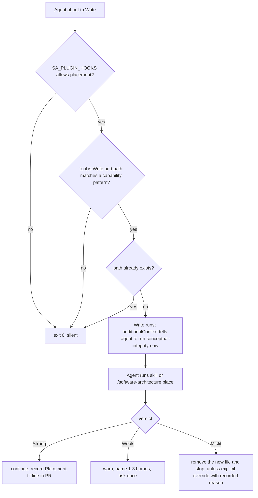

# Placement Fit Check - Plan

## Goal Capsule

- **Objective:** Before an agent writes a new skill, command, agent, hook, ADR or plugin into a repository, it has checked the capability against that host's declared intent and has warned the user when the fit is not Strong.
- **Means:** a `conceptual-integrity` skill and `/software-architecture:place` command that run the check, a PreToolUse reminder hook at the moment of creation, and a placement check in `architecture-reviewer` as the review-time backstop (KTD1, KTD2).
- **Authority:** the enterprise ADR SAE-027 (Accepted 2026-10-29) owns the rule; this plugin's `STRATEGY.md` Boundaries and `QUALITY.md` hook requirements constrain how it is built. R-IDs below win on behavior; KTDs win on mechanism.
- **Stop conditions:** stop if a change would hard-code an organization or repository name, make the hook deny a tool call, or make the hook execute any part of its input.
- **Execution profile:** test-first for the hook (U2); prose authoring for skill, command, agent and docs.
- **Who finishes:** Claude implements, opens a PR on `claude/project-thread-kc9utw`, and drives it to green. Kraig merges.

---

## Product Contract

### Summary

Add a placement fit check to the plugin. A skill defines the check and its verdicts. A command runs it on demand. A hook reminds the agent to run it when a new capability file is about to be written. The architecture reviewer flags a new capability whose verdict was not recorded.

### Problem Frame

Agents put new work in the repository that is open, or next to items with a similar name. A recent skill landed in a plugin whose purpose it did not serve, and the only recorded reason was its name prefix. SAE-027 makes a fit check mandatory before a new capability is written; nothing in the tooling performs or prompts it yet.

### Requirements

**The check**

- R1. The check reads the host's intent in the SAE-027 order and stops at the first source that states it: `STRATEGY.md`, the purpose section of `CLAUDE.md` or `AGENTS.md`, `.claude-plugin/plugin.json` description, `README.md`, the host's ADRs and plans, the Productboard product specification when a connector is available, the repository name. When a Productboard connector is available and a repository source stated the intent, the check also reads the Productboard specification and reports any disagreement; the repository's intent still decides the verdict.
- R2. The check searches the host's ADRs, the sibling repositories and enterprise ADR home listed in `ARCHITECTURE.md`, for a prior decision about the same capability. A listed repository that is not reachable in the session is reported as "not searched", never as an empty result.
- R3. The check returns exactly one verdict: Strong, Weak or Misfit, with the evidence quoted and its source named.
- R4. A Weak verdict warns, names one to three better homes, and asks the user once.
- R5. A Misfit verdict stops further work on the capability and removes any file already created for it, unless the user gives an explicit override, whose reason is recorded.
- R6. Name similarity and "the repository that is open" never stand as the only reason for a verdict.
- R7. The verdict and the homes considered are recorded on a line that starts `Placement fit:`, in the message of the commit that adds the capability, and repeated in the PR body or the ADR.

**Invocation**

- R8. `/software-architecture:place` runs the check for a described capability.

**Detection**

- R9. A PreToolUse hook adds a reminder to the agent's context when a `Write` would create a capability file that does not yet exist.
- R10. The hook stays silent for an existing file, a non-capability path, a non-`Write` tool, and when `SA_PLUGIN_HOOKS` is set without `placement`.
- R11. The architecture reviewer reports each new capability file in a diff and flags it when no `Placement fit:` line is recorded.

**Documentation**

- R12. `CONCEPTS.md` defines "Conceptual integrity" and "Placement fit check"; README and AGENTS.md counts, lists and the opt-out table include the new skill, command and hook.

### Key Decisions

- **A Weak verdict warns and asks once; it does not block.** Avoids warning fatigue; revisit if overrides exceed half. (session-settled: user-approved — chosen over a blocking Weak verdict: Kraig accepted SAE-027 with this default) Governs R4.
- **The repository's intent wins over the Productboard spec when they disagree, and the disagreement is reported.** The repository is versioned with the code. (session-settled: user-approved — chosen over Productboard precedence: SAE-027 resolved on acceptance) Governs R1.
- **This plugin is the home for the check.** Placement fit: Strong — conceptual integrity is an architectural characteristic, and STRATEGY.md positions the plugin as "the right architectural context, at the moment of change". (session-settled: user-approved — chosen over the engineering plugin or devops-excellence: devops-excellence owns only the later fitness-function enforcement) Governs R1–R12.

### Scope Boundaries

- The skill reads governing documents; it does not write a missing `STRATEGY.md` (STRATEGY.md Boundaries). It names `ce-strategy` for that.
- The hook covers capability files, not "a new top-level directory": a directory is created implicitly by its first file, so the file patterns already cover the cases that matter.

### Deferred to Follow-Up Work

- `STRATEGY.md` for the three most active plugins (SAE-027 Implementation step 3).
- A fitness function in `devops-excellence/fitness/` that fails a repository with no intent and non-goals (SAE-027 step 4).
- A test that README counts match the repository (QUALITY.md `readme-counts-match`).

---

## Planning Contract

### Key Technical Decisions

- KTD1. **The hook only adds `additionalContext`; it never denies the Write.** (session-settled: user-approved — chosen over a PreToolUse deny: SAE-027 Decision 3 plus the warn-not-block default) Governs R9. STRATEGY.md also requires hooks to warn before they block.
- KTD2. **Capability paths are matched by anchored regex on the path tail, and plugin-shaped paths only inside a plugin or `.claude/` root.** `.claude-plugin/plugin.json` and `docs/adr/<name>.md` match anywhere. `skills/<name>/SKILL.md`, `commands/<name>.md`, `agents/<name>.md` and `hooks/<name>` match only when the directory that holds `skills/`, `commands/`, `agents/` or `hooks/` contains `.claude-plugin/plugin.json` or is named `.claude`. This keeps `src/hooks/useAuth.ts` and `docs/commands/x.md` in ordinary product repositories silent. A shell glob `*` crosses `/`, so regex keeps `commands/sub/x.md` out.
- KTD3. **"New" means the target path does not exist on disk.** A relative `file_path` is resolved against the payload's `cwd`. The path is only passed to `[[ -e ]]` and to `jq --arg`; it is never evaluated (QUALITY.md `hooks-never-execute-input`).
- KTD4. **The hook's opt-out key is `placement`**, using the same `SA_PLUGIN_HOOKS` allow-list check as the other hooks.
- KTD5. **`Placement fit:` is the recorded marker.** The skill's output template and the reviewer's check share this literal, so the reviewer can find a verdict with one search of the PR body, ADRs and commit messages.
- KTD6. **With no declared non-goals, judge against the stated purpose, not the inventory.** A `plugin.json` description that lists contents is an inventory; the check reads past it to a purpose statement, and notes in the evidence that the host has no non-goals.
- KTD7. **The enterprise ADR home and the sibling repositories come from `ARCHITECTURE.md`**, through `software-architecture:adr-historian`, never from a hard-coded repository name or checkout layout (STRATEGY.md Boundaries).
- KTD8. **The reminder arrives after the write.** A PreToolUse `additionalContext` does not pause the tool, so the agent reads it once the file exists. The message says the file was just created, tells the agent to run the check before writing anything else for this capability, and to remove the file on a Misfit without an override (R5). The verdict rules themselves live only in the skill.

### High-Level Technical Design

### Sources

- SAE-027: `Integral-Productivity/software-architecture-excellence` `docs/adr/SAE-027-new-capabilities-pass-a-placement-fit-check.md`.
- Hook pattern: `hooks/deps-pretooluse.sh` (opt-out block, `jq` payload parsing, `additionalContext` output).
- Test pattern: `test/hooks.test.mjs` (`runHook`, `HAS_JQ` skip).
- Reviewer structure: `agents/architecture-reviewer.md` Step 3 checks A–D and the Step 4 report.

---

## Implementation Units

### U1. Conceptual-integrity skill and place command

- **Goal:** define the check and make it invocable.
- **Requirements:** R1–R8; KTD5, KTD6, KTD7, KTD8.
- **Files:** `skills/conceptual-integrity/SKILL.md`, `commands/place.md`.
- **Approach:** skill frontmatter per CONTRIBUTING.md (`name`, `description` with trigger phrases, `status: draft`, `version: 1.0.0`). Body: what counts as a capability, the intent read order, the prior-decision search, verdict rules, the output template with the `Placement fit:` line, override handling, and cross-references to `software-architecture:architecture-governance-levels` and `software-architecture:adr-historian`. The output template tells the agent to put the `Placement fit:` line in the commit that adds the capability. The command follows `commands/decide.md`: a numbered process that invokes the skill, with `$ARGUMENTS` as the capability description. No organization or repository names.
- **Test scenarios:** `npm test` frontmatter checks pass for the new skill and command.
- **Verification:** `grep -rni "integral" skills/conceptual-integrity commands/place.md` returns nothing.

### U2. Placement reminder hook

- **Goal:** remind the agent at the moment a new capability file is written.
- **Requirements:** R9, R10; KTD1–KTD4, KTD8.
- **Files:** `hooks/placement-pretooluse.sh` (executable), `.claude-plugin/hooks.json`, `test/hooks.test.mjs`.
- **Execution note:** write the behavioural tests first and watch them fail.
- **Approach:** register under the existing `Write|Edit` PreToolUse matcher as a second hook; the script itself filters to `Write`. The script exits 0 silently when `jq` is not on PATH (QUALITY.md `silent-exit-on-no-match`). The message names the capability kind and path, points to `software-architecture:conceptual-integrity` and `/software-architecture:place`, and carries the KTD8 post-write instruction; it does not restate the verdict rules.
- **Test scenarios:**
  - In a `<tmp>` plugin root (with `.claude-plugin/plugin.json`), a Write to a non-existent `skills/foo/SKILL.md` emits `PreToolUse` JSON whose `additionalContext` names `conceptual-integrity` and tells the agent to remove the file on a Misfit.
  - Same for `commands/foo.md`, `agents/foo.md`, `hooks/foo.sh` in that root, for `<tmp>/.claude/commands/foo.md`, and for `docs/adr/0009-x.md` and `.claude-plugin/plugin.json` in a bare `<tmp>`.
  - Write to an existing `skills/foo/SKILL.md` is silent.
  - Write to `<tmp>/src/index.ts` and to `<tmp>/commands/sub/foo.md` is silent.
  - With no plugin manifest, `<tmp>/src/hooks/useAuth.ts` and `<tmp>/docs/commands/foo.md` are silent.
  - `Edit` on a non-existent capability path is silent.
  - `SA_PLUGIN_HOOKS=deps` is silent; `SA_PLUGIN_HOOKS=placement` fires.
  - A relative `file_path` with `cwd` set resolves against `cwd`.
  - A hostile segment with no slash, `<tmp-plugin>/skills/$(touch pwned-placement)/SKILL.md`, still gets the reminder (so the existence check ran) and creates no `pwned-placement` file in `<tmp>` or the repo root.
  - With a PATH that lacks `jq`, the hook exits 0 with no output.
- **Verification:** `npm test` passes; the generic executable, `bash -n` and minimal-payload checks cover the new script.

### U3. Architecture-reviewer placement check

- **Goal:** catch a new capability whose verdict was not recorded.
- **Requirements:** R11; KTD5.
- **Files:** `agents/architecture-reviewer.md`.
- **Approach:** add Check E (new capability files from `git diff --name-status --diff-filter=A`, same patterns as KTD2; search, in order, changed ADRs, `git log <base>..HEAD` messages, and `gh pr view --json body` only when a PR exists and `gh` is available, for `Placement fit:`), a `### Placement Fit` report section, and a `NEEDS-PLACEMENT` severity flag. Update the description line.
- **Test scenarios:** Test expectation: none -- agent prose; frontmatter test covers the file.
- **Verification:** `npm test` passes.

### U4. Vocabulary and documentation

- **Goal:** keep shared vocabulary and the README inventory true.
- **Requirements:** R12.
- **Files:** `CONCEPTS.md`, `README.md`, `AGENTS.md`.
- **Approach:** two entries under "Architecture practice". README: 11 skills, 8 commands, 6 hooks, a hook row and a `placement` opt-out row. AGENTS.md repo map counts.
- **Test scenarios:** Test expectation: none -- docs only.
- **Verification:** counts match `ls skills commands hooks`.

---

## Verification Contract

| Gate | Command | Applies to |
|---|---|---|
| Unit and behaviour tests | `npm test` | U1–U3 |
| Hook syntax | `bash -n hooks/placement-pretooluse.sh` (in `npm test`) | U2 |
| No hard-coded org | `grep -rni "integral" skills/conceptual-integrity commands/place.md hooks/placement-pretooluse.sh` returns nothing | U1, U2 |
| Quality model | `qualitymd lint QUALITY.md` when the tool is installed | all |

## Definition of Done

- All R1–R12 are met and `npm test` passes with `jq` present.
- The PR body starts with the attribution lines and carries `Placement fit: Strong` with the homes considered.
- No experimental or dead code from abandoned attempts remains in the diff.
